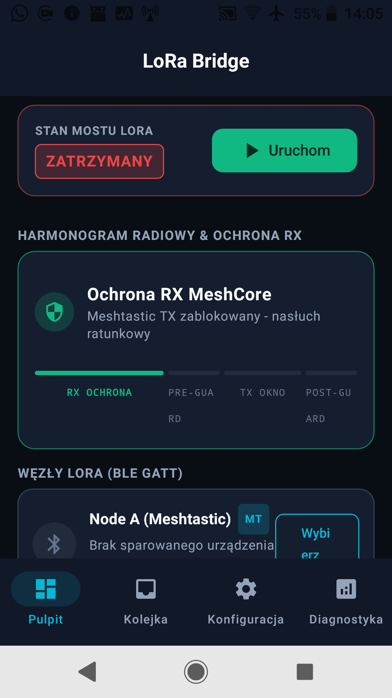

# LoRa Bridge – Inteligentny most Meshtastic ↔ MeshCore

   



**LoRa Bridge** to aplikacja na Androida, która zamienia stary telefon w autonomiczny, **asymetryczny most komunikacyjny** między sieciami LoRa **Meshtastic** i **MeshCore** – działający w 100% offline, bez serwerów, Internetu, chmury i MQTT.

Dwa urządzenia LoRa pracujące w niewielkiej odległości od siebie (np. 2 m) na wspólnym paśmie (np. EU868) wzajemnie się zakłócają – silna transmisja modułu Meshtastic może zagłuszyć czuły tor odbiorczy MeshCore i uniemożliwić odbiór słabych sygnałów z odległych węzłów ratunkowych. LoRa Bridge rozwiązuje ten problem zarządzanym harmonogramem radiowym:

- **Ochrona RX MeshCore** – w wyznaczonych oknach czasowych most wstrzymuje własne nadawanie do Meshtastic, chroniąc tor odbiorczy MeshCore.
- **P0 (MeshCore → Meshtastic)** – komunikaty ratunkowe z MeshCore są przekazywane do rozległej sieci Meshtastic natychmiast, z preempcją harmonogramu.
- **P1 (Meshtastic → MeshCore)** – wiadomości z Meshtastic są buforowane i wysyłane do MeshCore wyłącznie w wyznaczonych oknach transmisji, z zachowaniem czasów ochronnych (guard time).
- **Trwały bufor Store-and-Forward** – kolejka w bazie SQLite przeżywa restart aplikacji, restart starego telefonu i chwilowe zerwanie połączenia Bluetooth.

## Pobieranie

- **APK (v1.1):** [`LoRa-bridge1.1.apk`](LoRa-bridge1.1.apk) (ok. 23 MB)
- **Release:** [github.com/StrazPrzyszlosci/LoRa-bridge/releases](https://github.com/StrazPrzyszlosci/LoRa-bridge/releases)
- Wcześniejsze wydanie: [v1.0](https://github.com/StrazPrzyszlosci/LoRa-bridge/releases/tag/v1.0)

SHA-256 pliku APK: `e4cd67d8c0ea34e30b0bb6c89b528d774054ddaa22c5a2e0362cb01df973a640`

## Zmiany w v1.1

- **Zgodność z oficjalnymi protokołami**: Meshtastic PhoneAPI (surowy protobuf `ToRadio`/`FromRadio`, sesja `want_config_id`, notyfikacje `FromNum` i odczyt skrzynki FromRadio, poprawny UUID serwisu `6ba1b218-…`) oraz MeshCore Companion (handshake `APP_START`/`DEVICE_QUERY`/`SET_DEVICE_TIME`, kolejka komend z timeoutem, wysyłka kanałowa z potwierdzeniem `MSG_SENT`, odbiór push `0x83` + poll `0x0A`).
- **Auto-reconnect z backoffem** (2/5/15/30 s) dla obu węzłów oraz **zapamiętywanie adresów BLE** – po restarcie most łączy się sam.
- **MTU 512** na obu węzłach i **dzielenie długich wiadomości** ze znacznikami `[n/N]`.
- **Skaner** rozpoznaje typ węzła po UUID serwisu z reklamy (nazwa tylko jako fallback).
- **Telemetria SNR** z ramek MeshCore V3 i pakietów Meshtastic (zdarzenia `RF_TELEM` w Diagnostyce).
- Testy jednostkowe golden-frame obu protokołów (`ProtocolCodecUnitTest`).

---

## Dla testerów: instaluj na starym smartfonie („leżak szufladowy”)

Do testów używaj **starego, sprawnego telefonu – „leżaka szufladowego” z szuflady** – a nie swojego codziennego smartfona:

- Stary telefon z mostem pracuje jako **dedykowany węzeł łączności całodobowej** – usługa w tle (Foreground Service) i dwa połączenia BLE działają bez przerwy, także przy wygaszonym ekranie.
- To **obciąża akumulator** – most powinien pracować na stałym zasilaniu (podłącz ładowarkę).
- Aplikacja **zajmuje adapter Bluetooth** na wiele godzin i utrzymuje stałe powiadomienie systemowe.
- Niechciany restart lub aktualizacja systemu na codziennym telefonie zerwie most i połączenia z węzłami.

**Wymagania wobec „leżaka”:** Android 7.0+ (API 24), sprawny Bluetooth LE, stałe zasilanie, wyłączona optymalizacja baterii dla aplikacji, Bluetooth włączony na stałe.

## Instalacja krok po kroku

1. Pobierz `LoRa-bridge1.1.apk` na stary telefon (przeglądarką, przez dysk lub kablem).
2. Otwórz plik – jeśli system zapyta, zezwól na **instalację z nieznanych źródeł** dla aplikacji, której używasz do otwarcia pliku (np. menedżera plików).
3. Zainstaluj i uruchom aplikację **LoRa Bridge**.
4. Przy pierwszym starcie **zaakceptuj wszystkie uprawnienia**:
   - Android 12+ – *Bluetooth* (skanowanie i łączenie) oraz *powiadomienia* (Android 13+),
   - Android 11 i starsze – *dostęp do lokalizacji* (wymagany przez system do skanowania BLE).
5. W ustawieniach starego telefonu **wyłącz optymalizację baterii** dla LoRa Bridge (Ustawienia → Bateria / Aplikacje), a najlepiej zezwól też na autostart – inaczej system może przerwać działający w tle most.

Kolejne wersje testowe są podpisane tym samym kluczem debug, więc aktualizacje instaluje się bezpośrednio „nad” poprzednią wersją, bez odinstalowywania.

---

## Instrukcja obsługi

Aplikacja ma 4 zakładki w dolnym pasku nawigacji: **Pulpit**, **Kolejka**, **Konfiguracja**, **Diagnostyka**.

### Pierwsze uruchomienie – postawienie mostu

1. Włącz w starym telefonie Bluetooth.
2. Wejdź w zakładkę **Konfiguracja** i kliknij **Skanuj urządzenia BLE**.
3. Gdy na liście pojawią się Twoje węzły, kliknij przy odpowiednim urządzeniu:
   - **Przypisz jako Meshtastic (A)** – węzeł Meshtastic,
   - **Przypisz jako MeshCore (B)** – węzeł MeshCore.

   Skaner rozpoznaje typ urządzenia po reklamowanym UUID serwisu (Meshtastic `6ba1b218-…`, MeshCore NUS `6e400001-…`), a przy jego braku po nazwie („Meshtastic”, „T-BEAM”, „Heltec” → Meshtastic; „MeshCore”, „Companion”, „Nordic”, „RAK” → MeshCore). Dowolne urządzenie możesz też przypisać do dowolnej roli ręcznie.
4. Wróć na **Pulpit** i kliknij **Uruchom**. Status mostu zmieni się na **AKTYWNY**, a w pasku powiadomień pojawi się stałe powiadomienie z bieżącą fazą harmonogramu i liczbą alarmów P0 w kolejce. Od tej chwili most działa w tle, także przy zgaszonym ekranie.
5. Ustaw parametry w zakładce **Konfiguracja** i kliknij **Zapisz i Zastosuj Konfigurację**.

> **Ważne:** most zapamiętuje adresy obu węzłów (baza SQLite). Po restarcie aplikacji lub starego telefonu wystarczy kliknąć **Uruchom** – most połączy się z zapamiętanymi węzłami automatycznie; ręczne skanowanie jest potrzebne tylko przy zmianie sprzętu. Zapisane parametry harmonogramu przywracają się w polach Konfiguracji, ale są stosowane do działającego harmonogramu dopiero po **Zapisz i Zastosuj**.

### Zakładka Pulpit (stan mostu i RF)

- **Karta „Stan mostu LoRa”** – status **AKTYWNY / PAUZA / ZATRZYMANY**, przyciski **Uruchom / Wstrzymaj** oraz **Zatrzymaj** (zatrzymanie rozłącza oba węzły).
- **Baner alarmu P0** – pulsujący czerwony baner widoczny, gdy w kolejce czekają krytyczne komunikaty P0.
- **Wskaźnik harmonogramu radiowego** – bieżąca faza z odliczaniem i paskiem 4 segmentów:
  - *Ochrona RX MeshCore* (zielona) – most nasłuchuje i nie nadaje do Meshtastic,
  - *Czas ochronny Pre-TX / Post-TX* (bursztynowa) – wyciszenie medium przed/po nadawaniu,
  - *Okno transmisji TX* (cyjanowa) – most wysyła zakolejkowane wiadomości.
- **Karty węzłów A/B** – nazwa urządzenia, status połączenia GATT („Gotowy (GATT OK)” = pełne połączenie z włączonymi powiadomieniami) oraz sygnał **RSSI [dBm]**; przycisk **Rozłącz / Wybierz**.
- **Telemetria mostu** – kafelki: oczekujące P0, kolejka łącznie, przekazane, kolizje uniknięte.
- **Moduł „Test transmisji mostu”** – wpisz tekst i kliknij **MC → MT (P0 SOS)** lub **MT → MC (P1)**, aby wstrzyknąć pakiet, jakby przyszedł z danej sieci. To najlepszy sposób na przetestowanie pełnej ścieżki (kwalifikacja → deduplikacja → kolejka → harmonogram) **bez żadnego sprzętu radiowego**.

### Zakładka Kolejka (Store-and-Forward)

- Filtry: **Wszystkie / Oczekujące / Wysłane / Błędy** (błędy razem z wygasłymi).
- Karta wiadomości pokazuje: kierunek (**MC → MT** / **MT → MC**), priorytet (**P0 CRITICAL / P1 HIGH / P2 TECHNICAL**), status (*Oczekuje / Wysyłanie / Dostarczona / Wygasła / Błąd*), treść, czas przyjęcia i licznik prób.
- **Ponów** – ręczne ponowne zakolejkowanie wiadomości ze statusem błędu/wygasłej; **Usuń** – usunięcie pojedynczej wiadomości; ikona kosza u góry – wyczyszczenie całej historii (z potwierdzeniem).
- Kolejka jest zapisana w SQLite – dane przeżywają restart aplikacji i starego telefonu.

### Zakładka Konfiguracja

- **Skaner i połączenia BLE** – start/stop skanowania, lista wykrytych urządzeń (nazwa, adres MAC, RSSI) i przypisanie do roli Meshtastic (A) lub MeshCore (B).
- **Parametry harmonogramu radiowego** (suwaki):
  - Okno ochrony RX MeshCore: **5–60 s** (domyślnie 15 s),
  - Okno nadawania TX: **2–20 s** (domyślnie 5 s),
  - Guard Time pre/post TX: **200–2000 ms** (domyślnie 800 ms).
- **Kwalifikacja wiadomości krytycznych** – lista słów kluczowych rozdzielonych przecinkami (domyślnie: `!SOS, !ALERT, !EMERGENCY, POMOC, RATUNEK`). Wiadomość przechodzi przez most tylko, gdy zawiera jedno z tych słów.
- **Zapisz i Zastosuj Konfigurację** – zapisuje parametry na stałe (baza SQLite) i natychmiast stosuje je do działającego harmonogramu.

### Zakładka Diagnostyka

- Kafelki: **szacowany airtime LoRa** (sekundy; wyliczenie dla EU868/SF9: 0,35 s preambuły + ~14 ms/bajt), **przekazane**, **kolizje blokowane**.
- **Log zdarzeń** (ostatnie 200) z filtrami: Wszystkie / P0 Alarmy / Scheduler RF / Błędy. Rejestrowane typy zdarzeń to m.in. `P0_ALARM`, `RF_SCHEDULER`, `QUEUE_ENQUEUE`, `QUEUE_EVENT`, `FILTER_REJECT`, `DUPLICATE_DROP`, `ERROR`, `TEST_INJECT`, `SERVICE`, `CONFIG`, `RF_TELEM`.
- **Eksport logów** (ikona udostępniania) – cały rejestr jako tekst przez systemowy dialog (e-mail, dysk, komunikator); ikona kosza czyści rejestr.

---

## Jak działa most

### Harmonogram radiowy (RadioScheduler)

1. **Ochrona RX MeshCore** (domyślnie 15 s) – most nie nadaje do Meshtastic; w tle wygasają stare wiadomości (TTL).
2. Po upływie okna: jeśli bufor jest **pusty**, most pozostaje w ochronie RX i nie przerywa nasłuchu.
3. Jeśli są oczekujące wiadomości: **Guard Pre-TX** (800 ms) → **Okno TX** (5 s – wysyłka wg priorytetów, P0 pierwsze, 300 ms odstępu między ramkami) → **Guard Post-TX** (800 ms) → powrót do ochrony RX.
4. **Preempcja P0**: kwalifikujący się alarm z MeshCore wstrzymuje zaplanowane zadania – po ~250 ms (stabilizacja toru BLE) most nadaje go do Meshtastic natychmiast, poza kolejnym oknem TX, a po transmisji odsłania guard time i wraca do ochrony RX.
5. Aktywność MeshCore jest rejestrowana w logach diagnostycznych (`RF_SCHEDULER`).

### Kwalifikacja i priorytety (BridgeEngine)

- Wiadomość przechodzi przez most **tylko wtedy**, gdy zawiera jedno ze słów kluczowych (wielkość liter bez znaczenia). Zwykłe rozmowy są odrzucane (zapis `FILTER_REJECT`).
- **P0 CRITICAL** – alarm z MeshCore ze słowem kluczowym; do **5** prób retransmisji; natychmiastowa preempcja.
- **P1 HIGH** – alarm z Meshtastic; do **3** prób; buforowany do okna TX.
- Treść jest opatrzona znacznikami kierunku **[MC→MT]** lub **[MT→MC]** (plus **[ALERT]**). Wiadomość wracająca z sieci źródłowej z takim znacznikiem jest odrzucana – to ochrona przed zapętlaniem.
- **Deduplikacja** – SHA-256 z (sieć źródłowa + nadawca + kanał + treść); duplikat w ciągu **5 minut** jest pomijany (`DUPLICATE_DROP`).
- Filtr kanałów: przekazywane są kanały 0–1. Biała lista nadawców istnieje w silniku, ale domyślnie jest pusta (przechodzi każdy nadawca).

### Trwały bufor Store-and-Forward (Room / SQLite)

- Każda zakwalifikowana wiadomość jest zapisywana do bazy **przed** próbą wysyłki – utrata zasilania lub zerwanie BLE nie powoduje utraty danych.
- **TTL 30 minut** – niezdążone wiadomości wygasają (`EXPIRED`).
- Błąd transmisji → ponowne zakolejkowanie z licznikiem prób; po wyczerpaniu limitu status `FAILED` z opisem błędu.
- Status „Dostarczona” oznacza, że węzeł przyjął ramkę (MeshCore potwierdza to komendą `MSG_SENT`, Meshtastic – zapisem do `ToRadio`); aplikacja rejestruje też ACK-i nadania radiowego (zdarzenia `QUEUE_EVENT`), ale nie wiąże ich jeszcze z konkretną wiadomością w kolejce.

### Podsumowanie parametrów domyślnych

| Parametr | Domyślnie | Zakres |
|---|---|---|
| Okno ochrony RX MeshCore | 15 s | 5–60 s |
| Okno transmisji TX | 5 s | 2–20 s |
| Guard Time (pre/post TX) | 800 ms | 200–2000 ms |
| Odstęp między ramkami w oknie TX | 300 ms | – |
| Bezpieczny odstęp preempcji P0 | 250 ms | – |
| TTL wiadomości | 30 min | – |
| Maks. prób retransmisji | P0: 5 / P1, P2: 3 | – |
| Okno deduplikacji | 5 min | – |
| Słowa kluczowe | `!SOS, !ALERT, !EMERGENCY, POMOC, RATUNEK` | dowolne |

---

## Wymagania

- Android **7.0+** (minSdk 24; aplikacja celuje w SDK 36) oraz **Bluetooth Low Energy**.
- Węzeł **Meshtastic** z aktywną usługą BLE (serwis UUID `6ba1b218-15a8-461f-9fa8-5dcae273eafd`) – adapter negocjuje MTU 512, otwiera sesję `want_config_id`, subskrybuje notyfikacje `FromNum` i odczytuje skrzynkę `FromRadio`.
- Węzeł **MeshCore** z usługą **Nordic UART** (serwis UUID `6e400001-b5a3-f393-e0a9-e50e24dcca9e`) – adapter negocjuje MTU 512 i mówi binarnym protokołem Companion; w razie braku NUS próbuje dowolnego serwisu z charakterystyką zapisu i powiadomień.
- Oba węzły w zasięgu Bluetooth starego telefonu.

## Co jest zaimplementowane (zweryfikowane w kodzie źródłowym)

- **Podwójna architektura BLE** – `MeshtasticBleAdapter` (protokół PhoneAPI: protobuf `ToRadio`/`FromRadio`, sesja `want_config_id`, notyfikacje `FromNum`, odczyt skrzynki `FromRadio`, `want_ack`, MTU 512) i `MeshCoreBleAdapter` (binarny protokół Companion: handshake, kolejka komend z timeoutem, `MSG_SENT`, push/pull wiadomości, SNR, MTU 512), oba za wspólnym interfejsem `BleNodeTransport` z auto-reconnectem i zapamiętywaniem adresów (umożliwia też testy bez sprzętu).
- **Skaner BLE** (`BleDeviceScanner`) z rozpoznawaniem typu węzła po UUID serwisu z reklamy (fallback: heurystyka nazwy).
- **RadioScheduler** – maszyna faz RX / Guard Pre / TX / Guard Post, preempcja P0, licznik szacowanego airtime (EU868/SF9), wygasanie TTL w tle.
- **BridgeEngine** – kwalifikacja słów kluczowych, priorytety P0/P1/P2, filtr kanałów, biała lista nadawców, ochrona przed pętlami ([MC→MT] / [MT→MC]), hash deduplikacyjny SHA-256.
- **Trwała baza Room (SQLite)** – tabele `bridge_messages` (kolejka), `bridge_diagnostic_events` (logi), `bridge_configs` (konfiguracja); reaktywne strumienie `Flow` aktualizujące UI.
- **BridgeForegroundService** – usługa w tle typu `connectedDevice`, stałe powiadomienie (faza harmonogramu + liczba P0 w kolejce), flaga `START_STICKY`, sterowanie START / PAUSE / STOP.
- **UI Jetpack Compose (Material 3)** w stylistyce **Tactical Dark** – 4 zakładki, animowany wskaźnik faz z paskiem segmentów, pulsujący baner P0, karty węzłów z RSSI, kafelki telemetrii, moduł wstrzykiwania pakietów testowych, eksport logów przez systemowy dialog.
- **Testy jednostkowe** (`BridgeEngineUnitTest`): kwalifikacja P0/P1, wykrywanie pętli, odrzucanie zwykłych rozmów, stabilność hasha deduplikacji; (`ProtocolCodecUnitTest`): golden-frame protokołów Meshtastic i MeshCore; test Robolectric i test instrumentowany.

## Architektura (skrót)

```
Jetpack Compose UI (Pulpit / Kolejka / Konfiguracja / Diagnostyka)
        │  StateFlow
BridgeViewModel ── bindService ──► BridgeForegroundService (typ connectedDevice)
                                        ├─ BridgeEngine (kwalifikacja / priorytety / dedup)
                                        ├─ RadioScheduler (okna RX / TX / guard, preempcja P0)
                                        ├─ Room SQLite (Store-and-Forward + logi + konfiguracja)
                                        └─ Adaptery BLE ──► Node A: Meshtastic
                                                   └────► Node B: MeshCore
```

## Znane ograniczenia wersji 1.1

1. **Build debug** – podpisany testowym certyfikatem; przeznaczony do testów, nie do dystrybucji produkcyjnej.
2. **Zgodność łącza wymaga testów w terenie** – od v1.1 aplikacja mówi oficjalnymi protokołami (Meshtastic PhoneAPI, MeshCore Companion), ale współpraca z fabrycznym firmware obu systemów powinna zostać potwierdzona na prawdziwych węzłach (v1.0 używała ramek uproszczonych).
3. Filtr słów kluczowych jest **zawsze aktywny** (brak przełącznika w UI) – przez most przechodzą wyłącznie komunikaty alarmowe; zwykłe rozmowy są odrzucane przez założenie.
4. Tryb adaptacyjny w tej wersji **rejestruje aktywność MeshCore w logach**, ale jeszcze nie wydłuża automatycznie okna ochrony RX.
5. Kafelek „Kolizje uniknięte” nie ma jeszcze źródła zdarzeń – w wersji 1.1 pozostaje na 0.
6. Aplikacja steruje wyłącznie transmisjami przez siebie inicjowanymi – firmware węzłów może autonomicznie nadawać beacony i retransmisje mesh (most nie może tego wyłączyć; informacja o tym jest też w aplikacji).
7. ACK-i nadania radiowego (Meshtastic `want_ack`, MeshCore `PACKET_ACK`) są rejestrowane w logach, ale nie są jeszcze mapowane na status „Dostarczona” konkretnej wiadomości w kolejce.

## Informacje o buildzie

| | |
|---|---|
| Plik | `LoRa-bridge1.1.apk` |
| Wersja | 1.1 (manifest: 1.0, versionCode 1) |
| Wariant | debug |
| Minimalny Android | 7.0 (API 24) |
| Docelowy SDK | 36 |
| SHA-256 | `e4cd67d8c0ea34e30b0bb6c89b528d774054ddaa22c5a2e0362cb01df973a640` |

## Zgłaszanie uwag i błędów

Obserwacje z testów zgłaszaj w zakładce Issues: <https://github.com/StrazPrzyszlosci/LoRa-bridge/issues>.
Do zgłoszenia dołącz eksport logów z zakładki **Diagnostyka** – znacznie ułatwia to analizę.

---

*Repozytorium zawiera wyłącznie dystrybucję testową: `LoRa-bridge1.1.apk`, `screenshot.jpg` i niniejszy plik README. Kod źródłowy nie jest publikowany.*
